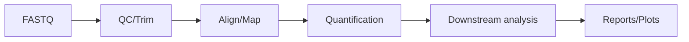

# miRDeep-P3
A comprehensive pipeline for plant miRNA discovery, annotation and downstream functional analysis from small RNA (sRNA) sequencing data.

> **Current versions** — software **v3.1.8e** · data index **`mirdeep-p3-v3.1.4c-full`**
>
> The code and the data index (Rfam / mature / PmiREN BLAST indices) are released on
> two independent schedules, so the index tag is tracked separately from the version
> above; its single source of truth is [`data-index.env`](data-index.env). Changing or
> upgrading the index means touching a few more files — follow the checklist in
> [`docs/DATA-INDEX.md`](docs/DATA-INDEX.md).

## Highlights

- **End-to-end miRNA discovery** — from raw sRNA-seq FASTQ to annotated
  mature/precursor miRNAs in a single workflow (identification →
  annotation → downstream analysis).

- **Multi-group comparison** — parallel processing of groups
  (`-r`/`--replicate`) with consistent miRNA family naming across groups
  and runs (`--common`/`--consistency`).

- **Rich downstream analysis** — target prediction (psRNATarget-based),
  TFBS/promoter analysis (PlantTFDB), expression, enrichment and network
  modules, all in one tool.

- **Reproducible & publication-ready** — Docker/Conda packaged, multithreaded,
  and every figure exported in SVG/PDF/PNG formats.


## Table of Contents
- [Introduction](#introduction)
- [Workflow](#workflow)
- [Requirements](#requirements)
- [Installation](#installation)
- [Usage](#usage)
- [Examples](#examples)
- [Reproducibility](#reproducibility)
- [Testing](#testing)
- [Troubleshooting / FAQ](#troubleshooting--faq)
- [Citation](#citation)
- [License](#license)
- [Contributing](#contributing)
- [Contact](#contact)
- [Acknowledgements](#acknowledgements)

---

## Introduction

**mirdeep-p3** is an end-to-end pipeline for **plant miRNA discovery and
functional annotation** using **small RNA-seq data and comparative
genomics approaches**. It extends the classic miRDeep framework with
multi-sample comparison, family-level naming consistency, and a complete
suite of downstream analyses.

Typical use cases:
- Identify **novel and conserved miRNAs** from raw sRNA-seq data of any
  plant species, with stem-loop structure validation and mature/star
  annotation
- Perform **downstream analysis** in one place: target
  prediction (psRNATarget-based), promoter/TFBS analysis (PlantTFDB),
  differential expression, GO/KEGG enrichment and regulatory networks
- Generate **publication-ready figures** (SVG/PDF/PNG) and tables for
  manuscripts without extra scripting


If you use this software in academic work, please see [Citation](#citation).

## Workflow
> Figure: see `docs/workflow.png` (workflow diagram).



## Requirements

All dependencies are managed via conda. See
[`mirdp3_environment.yml`](mirdp3_environment.yml) for the full list.

**Core tools**: Python ≥3.9, R ≥4.2, Bowtie 1.3, Bowtie2, SAMtools,
BEDTools, SeqKit, ViennaRNA (RNAfold), Trim Galore

**Annotation/homology**: BLAST, HMMER, FASTA3 (ssearch), MMseqs2,
DIAMOND, eggNOG-mapper, MEME (FIMO), Prodigal, GFFread

**R plotting**: ggplot2, dplyr, tidyr, circlize, ComplexHeatmap,
svglite, patchwork, viridis, igraph/ggraph

**Bioconductor**: clusterProfiler, DESeq2, apeglm, enrichplot,
GOSemSim, DOSE, AnnotationForge, ggtree, Biostrings, GenomicRanges

## Installation
### Option A: Conda (recommended)
The conda package bundles all code and index data — install and use directly
(no extra downloads needed):

```bash
conda install -c jaguares mirdeep-p3
```

> The package includes the full `data/index` (isoform-in, rfam, mature
> indices), so miRNA identification and annotation work out of the box.
> **Note** : Please download the latest release tag from conda. https://anaconda.org/channels/jaguares/packages/mirdeep-p3/overview.

### Option B: From source
```bash
git clone https://github.com/YangXZ-lab/mirdeep-p3.git
cd mirdeep-p3

# Create the conda environment (all dependencies)
conda env create -f mirdp3_environment.yml -n mirdp3
conda activate mirdp3

# Optional: download index data (needed for identification/annotation;
# the conda and Docker packages already include it).
# The data index is versioned separately from the software: the Release below is
# recorded in data-index.env, which is what CI and test.sh read.
wget https://github.com/YangXZ-lab/mirdeep-p3/releases/download/mirdeep-p3-v3.1.4c-full/data-index.tar.gz
tar xzf data-index.tar.gz -C data/

# Optional but recommended: record which index release this is. It is
# reported at start-up and stored in the run manifest.
echo mirdeep-p3-v3.1.4c-full > data/index/.index-version

# Optional: add the miRDeep-P3 installation directory to your PATH.
# Replace /PATH/mirdeep-p3 with your actual installation path.
export PATH="/PATH/mirdeep-p3:$PATH"

chmod 755 mirdeep-p3
mirdeep-p3 -h

# Optional: install the standard console entry point. It keeps using
# this checkout, so data/ and scripts/ stay where they are.
pip install -e .
mirdeep-p3 -h
```

> The console script and `./mirdeep-p3` are the same program. Set
> `MIRDEEP_P3_HOME=/path/to/mirdeep-p3` if the tree moves later.

### Option C: Docker
```bash
# c1
wget https://github.com/YangXZ-lab/mirdeep-p3/releases/download/v3.1.6c-full/mirdeep-p3-3.1.6c-full.tar.gz
## Extract and import
gunzip -c mirdeep-p3-3.1.6c-full.tar.gz | docker load
## or
docker load -i mirdeep-p3-3.1.6c-full.tar.gz

## Make sure the image is loaded.
docker images | grep mirdeep

# c2
## Pull from Docker Hub / GHCR
docker pull merc3dez/mirdeep-p3:tagname (docker pull merc3dez/mirdeep-p3:3.1.6c-full)
docker pull crpi-rs803yb7s70369gn.cn-beijing.personal.cr.aliyuncs.com/merc3dez/mirdeep-p3:3.1.6c-full
## Optional: Rename to short name
docker tag merc3dez/mirdeep-p3:3.1.6c-full mirdeep-p3:3.1.6c-full

# View help
docker run --rm mirdeep-p3:3.1.6c-full -h
# Enter the container interactively (debug/view output)
docker run --rm -it -v $(pwd):/data mirdeep-p3:3.1.6c-full /bin/bash
```
> **Note**:
> 1. Docker images are hosted at https://hub.docker.com/r/merc3dez/mirdeep-p3/tags or https://cr.console.aliyun.com/repository/cn-beijing/merc3dez/mirdeep-p3/images. Please pull the latest tag.
> 2. Please download the latest release tag from GitHub.


## Usage
### Show help
```bash
mirdeep-p3 --help
```
### miRNA identification from sRNA-Seq
```bash
##1 Single input
mirdeep-p3 identification \
  -i <sample_1.fq.gz> \
  -o <output_dir> \
  -g <genome.fasta> \
  -d <bowtie_index_prefix> \
  -t <threads>

##2 Multiple inputs
mirdeep-p3 identification \
  -i <sample_1.fq.gz,sample_2.fq.gz,sample_3.fq.gz> \
  -o <output_dir> \
  -g <genome.fasta> \
  -d <bowtie_index_prefix> \
  -t <threads> \
  -p <progress>
```
| Parameter | Description | Example |
|---|---|---|
| `-i, --input` | Raw sequencing data (FASTQ/FASTA/compressed files, multiple samples can be separated by commas). | `[e.g., sample_1.fq or sample_1.fq,sample_2.fq,sample_3.fq]` |
| `-o, --output` | Output dir. | `[e.g., output]` |
| `-g, --genome` | Reference genome FASTA file. | `[e.g., genome.fasta]` |
| `-d, --index` | Path prefix of a pre-built bowtie index (optional). If not specified, the index is built automatically under the output directory; provide a prefix here to reuse an existing index and skip building. | `[e.g., bowtie_index_prefix]` |
| `-t, --threads` | Number of threads used in mirdeep-p3 (optional, default: 1). | `[e.g., 14]` |
| `-p, --progress` | Number of samples/files processed in parallel (optional, default: 1). For example, if 3 input files are provided, `-p 3` will process all three simultaneously. | `[e.g., 3]` |

| Path | Description |
|---|---|
| `output/mirdp3-identification-<time>.pipe` | Log for this task. |
| `output/mirdp3-identification-<time>.manifest.json` | Batch run manifest: one entry per sample (status + per-sample manifest path). |
| `output/<prefix>/<prefix>.run.json` | Per-sample run manifest: version, parameters, tool versions, input fingerprint, per-stage status and timings. |
| `output/<prefix>/<prefix>.fq_trimming_report.txt` | trim_galore report. |
| `output/<prefix>/<prefix>_identification.log` | Log for each step. |
| `output/<prefix>/<prefix>.total_reads` | Total reads count. |
| `output/<prefix>/<prefix>_filter_P_prediction` | Result of identification step. |

### Advanced
- **Custom reference build**: pass your own genome with `-g`; if `-d`
  is omitted, the bowtie index is auto-built under the output/index directory.
- **Skip steps**: `--no-reads_clean` skip the reads clean step.
- **Clean up**: `--clean` deletes each sample's `temp/` after the run, while the bowtie index under `output/index` is kept. Add `--clean-index` to delete the index as well (ignored when the index came from `-d`).
- **Resume an interrupted run**: `--resume` skips every stage whose artifacts are already on disk and whose record still matches the current inputs, parameters, genome and version. If any of them changed, the sample is re-run from the start instead of trusting stale files. `--clean` is ignored while resuming, because the intermediates under `temp/` are what makes resuming possible.
- **Data index release**: the software and the index are released on
  separate schedules, so start-up prints one line such as `[index] data
  index: mirdeep-p3-v3.1.4c-full (matches data-index.env)`. The line never
  changes a result and never aborts a run; the same state is recorded in the
  run manifest, and a changed tag invalidates `--resume`. Write one tag into
  `data/index/.index-version` to make the comparison possible; without it the
  line reports the release as unknown.
- **Console entry point**: `pip install -e .` puts `mirdeep-p3` on `PATH`
  (via `mirdeep_p3.cli`); it is equivalent to `./mirdeep-p3`.
- **Run record**: every sample writes `output/<prefix>/<prefix>.run.json` (version, parameters, tool versions, input fingerprint, per-stage status and duration), and the batch writes `output/mirdp3-identification-<time>.manifest.json`. Both are JSON and are written atomically, so a killed run never leaves a truncated file.

### miRNA annotation after identification
```bash
##1 Single input
mirdeep-p3 annotation \
  -i <output/sample_1> \
  -g <genome.fasta> \
  -d <bowtie_index_prefix> \
  --prefix <output prefix> \
  --prefix_miRNA <miRNA prefix> \
  --species <species> \
  -t <threads> \
  -o <output_dir>

##2 Multiple inputs
mirdeep-p3 annotation \
  -i <output/sample_1,output/sample_2,output/sample_3> \
  -g <genome.fasta> \
  -d <bowtie_index_prefix> \
  --prefix <output prefix> \
  --prefix_miRNA <miRNA prefix> \
  --species <species> \
  -t <threads> \
  -o <output_dir>
```
| Parameter | Description | Example |
|---|---|---|
| `-i, --input` | Output dir of miRNA identification step (multiple samples can be separated by commas). | `[e.g., sample_1 or sample_1,sample_2,sample_3]` |
| `-o, --output` | Output dir. | `[e.g., output]` |
| `-g, --genome` | Reference genome FASTA file. | `[e.g., genome.fasta]` |
| `-d, --index` | Path prefix of a pre-built bowtie index (optional). If not specified, the index is built automatically under the output directory; provide a prefix here to reuse an existing index and skip building. | `[e.g., bowtie_index_prefix]` |
| `-t, --threads` | Number of threads used in mirdeep-p3 (optional, default: 1). | `[e.g., 14]` |
| `--species` | Species name in the output (must be quoted). | `[e.g., "Arabidopsis thaliana"]` |
| `--prefix_miRNA` | miRNA prefix in the output (must be quoted). | `[e.g., "Ath"]` |
| `--prefix` | Prefix of output file (optional). | `[e.g., flower]` |
> **Note**:
> 1. If using FASTA format as input, please ensure that it is in collapsed FASTA format, with headers similar to `>read00001_x123`.
> 2. You can use `src/preprocess_files.py` to convert the input FASTA file into the required format.
| Path | Description |
|---|---|
| `output/mirdp3-annotation-<time>.pipe` | Log for this task. |
| `output/<prefix>/<prefix>-basic-info` | Result of annotation step. |
| `output/<prefix>/<prefix>_annotation.log` | Log for each step. |
| `output/<prefix>/<prefix>-basic-info-cluster` | miRNA cluster result. |
| `output/<prefix>/<prefix>-mature.count` | Read count matrix. |
| `output/<prefix>/<prefix>-mature.exp` | Expression matrix. |

### Advanced
- **Custom reference build**: pass your own genome with `-g`; if `-d`
  is omitted, the bowtie index is auto-built under the output/index directory.
- **Skip steps**: `--no-reads_clean` skip the reads clean step.
- **Multi group**: `-r/--replicate` used for multigroup; if -r 3,3: the first three inputs form group A, the last three form group B. Each group is processed and reported independently.
- **prefix**: one prefix per group, comma-separated. The number of prefixes must match the number of groups (2 groups → 2 prefixes).
- **--common**: when more than one group is present, `--common` unifies the naming of non-conserved miRNA families across groups, ensuring family names are consistent between groups for downstream comparison.
- **--consistency**: path to a reference basic-info file produced by a previous `mirdeep-p3 annotation` run (same format). When provided, the current annotation is forced to keep miRNA naming consistent with that reference — i.e. the same miRNA will receive the same name in both datasets. This is useful when re-annotating the same species or when merging annotations across groups.

### miRNA annotation result statistics
```bash
mirdeep-p3 analysis Stat \
  -i <basic-info> \
  -o <output_dir> \
  --rnaplot
```
| Parameter | Description | Example |
|---|---|---|
| `-i, --input` | Result of annotation step (basic info file). | `[e.g., sample-basic-info]` |
| `-o, --output` | Output dir. | `[e.g., output]` |
| `--rnaplot` | Plotting miRNA Stem-loop structure (optional). | `[e.g., --rnaplot]` |

| Path | Description |
|---|---|
| `output/base_dist.svg` | Base composition distribution. |
| `output/first_base_dist.svg` | First base composition distribution. |
| `output/length_dist.svg` | miRNA length distribution. |
| `output/miRNA_family.svg` | miRNA family distribution. |
| `output/Ath-MIR156a_ss.svg` | Stem-loop structure of Ath-MIR156a. |
> **Note**: All figures except miRNA Stem-loop structure are also exported in **PDF and PNG** formats
> (e.g. `base_dist.pdf`, `base_dist.png`) — use whichever suits your.

### miRNA target identification
```bash
mirdeep-p3 analysis Target_finder \
  -i <mature_miRNA.fasta> \
  -c <cds.fasta> \
  -o <output_dir> \
  -t <threads>
```
The command above runs the built-in psRNATarget-compatible engine, the default since
3.1.7b (no ssearch36 / seqkit required). The historical ssearch36 engine is still
available:
```bash
mirdeep-p3 analysis Target_finder --engine ssearch \
  -i <mature_miRNA.fasta> \
  -c <cds.fasta> \
  -o <output_dir> \
  -t <threads>
```
| Parameter | Description | Example |
|---|---|---|
| `-i, --input` | miRNA mature sequences (fasta). | `[e.g., sample-mature.fasta]` |
| `-o, --output` | Output dir. | `[e.g., output]` |
| `-t, --threads` | Number of threads used in mirdeep-p3 (optional, default: 1). | `[e.g., 20]` |
| `-b, --basic` | Result of annotation step (basic info file, conflict with `-i`). | `[e.g., sample-basic-info]` |
| `-e, --evalue` | E-value threshold for target prediction (optional, default: 2.5). | `[e.g., 30]` |
| `--GUs` | Allowed G:U mismatches in the complementary region (optional, default: 1; `--engine ssearch` only). | `[e.g., 0.5]` |
| `--engine` | Alignment engine (optional, default: psrna). `psrna`: built-in psRNATarget-compatible scanner, no ssearch36 needed. `ssearch`: ssearch36 + MiRNATarget parser, the historical path. | `[e.g., ssearch]` |
| `--allow-gap / --no-allow-gap` | `--engine psrna` only: whether to report sites carrying a single-base indel (optional, default: on). `--no-allow-gap` restricts the output to indel-free sites. | `[e.g., --no-allow-gap]` |
| `--psrna-detail` | `--engine psrna` only: also write the native 14-column psRNATarget table (optional). | `[e.g., --psrna-detail]` |
| `--max-hsp` | `--engine ssearch` only: ssearch36 `-b` value, i.e. the maximum number of HSPs reported per miRNA (optional, default: 200). | `[e.g., 2000]` |
| `--keep-temp` | Keep the intermediate files in `<output>/temp` instead of deleting them at the end of the run (optional). | `[e.g., --keep-temp]` |

| Path | Description |
|---|---|
| `output/target_finder.tsv` | miRNA target identification results, 6 columns: miRNA, target, mature length, target start, target end, expectation. |
| `output/target_finder.psrna.tsv` | Native psRNATarget 14-column table (only with `--psrna-detail`). |
> **Notes**:
> 1. The scoring scheme follows **psRNATarget** (https://www.zhaolab.org/psRNATarget/). `--engine psrna` (default since 3.1.7b) runs the built-in reimplementation; `--engine ssearch` applies the same rules on top of the scripts from [jtremblay/mirnatarget](https://github.com/jtremblay/mirnatarget). Details, rules and validation: `docs/PSRNA-ENGINE.md`.
> 2. Prediction stringency can be tuned with `-e/--evalue`. `--GUs` applies to `--engine ssearch` only, because psRNATarget V2 has no G:U cap.
> 3. On archived psRNATarget output the default engine returns 99.6-99.8% of the reported miRNA-target pairs, against 62.6% for `--engine ssearch`, whose recall is limited by the ssearch36 `-b 200` HSP cap (raise it with `--max-hsp`). Rows are always written in a fixed order (mature FASTA order, then target, then start).
> 4. When a basic-info file from a previous `annotation` run is available, `-b/--basic` is preferred over `-i/--input`, since it carries family and strand information that improves target prediction.
> 5. Since **ssearch36** cannot accept excessively long input paths, it is recommended that the character length of the parameter path not exceed 100 (`--engine ssearch` only).
> 6. Intermediates are written to `<output>/temp` and deleted when the run finishes; `--keep-temp` keeps them for inspection.

### miRNA promoter analysis
```bash
mirdeep-p3 analysis TFBS \
  -i <basic-info> \
  --fai <genome.fasta.fai> \
  -g <genome.fasta> \
  -o <output_dir> \
  -p
```
| Parameter | Description | Example |
|---|---|---|
| `-i, --input` | Result of annotation step. | `[e.g., sample-basic-info]` |
| `-o, --output` | Output dir. | `[e.g., output]` |
| `--fai` | fai index of reference genome. | `[e.g., genome.fasta.fai]` |
| `-g, --genome` | Reference genome FASTA file. | `[e.g., genome.fasta]` |
| `-p, --picture` | Generate TFBS report picture. | `[e.g., -p]` |
| `-s, --species` | Species name, quoted (optional, default: Arabidopsis_thaliana). | `[e.g., "Arabidopsis_lyrata"]` |
| `--list` | List available species. | `[e.g., --list]` |
| `-b, --bed` | Bed format input (conflict with `-i`). | `[e.g., sample-basic-info.bed]` |
| `-u, --upstream` | Upstream length to extract (default: 2000). | `[e.g., 3000]` |
| `-e, --evalue` | E-value threshold for FIMO (default: 1e-6). | `[e.g., 1e-6]` |

| Path | Description |
|---|---|
| `output/TFBS_count.svg` | TFBS count per miRNA. |
| `output/TFBS_distribution.svg` | TFBS distribution per miRNA. |
| `output/tfbs.tsv` | Result of miRNA promoter analysis. |
| `output/TF_family_count.svg` | TFBS Count per TF Family. |
| `output/TF_miRNA_network.svg` | TF–miRNA regulatory network. |
| `output/tfbs.log` | Log for each step. |
> **Note**:
> 1. All figures are also exported in **PDF and PNG** formats
>    (e.g. `TFBS_count.pdf`, `TFBS_count.png`) — use whichever suits your needs.
> 2. TFBS prediction follows the workflow of **PlantTFDB** (https://planttfdb.gao-lab.org/); all available species data are also sourced from PlantTFDB.

### miRNA differential expression analysis
```bash
mirdeep-p3 analysis Differential_expression \
  -c <mature.count> \
  -r <mature.exp> \
  --case1 <Columns corresponding to control group> \
  --case2 <Columns corresponding to treatment group> \
  -o <output_dir> \
  --case1name <control> \
  --case2name <treatment> \
  --DEOnly
```
| Parameter | Description | Example |
|---|---|---|
| `-c, --count` | Read count matrix. | `[e.g., sample-mature.count]` |
| `-r, --rpm` | Expression matrix. | `[e.g., sample-mature.exp]` |
| `--case1` | Columns corresponding to samples in the control group (separated by commas). | `[e.g., 3,4,5]` |
| `--case2` | Columns corresponding to samples in the treatment group (separated by commas). | `[e.g., 6,7,8]` |
| `-o, --output` | Output dir. | `[e.g., output]` |
| `--case1name` | Name of control group (optional, default: case1, must be quoted). | `[e.g., "flower"]` |
| `--case2name` | Name of treatment group (optional, default: case2, must be quoted). | `[e.g., "root"]` |
| `--DEOnly` | Display only the expression patterns of differentially expressed miRNAs (optional). | `[e.g., --DEOnly]` |
| `--miRNA` | Comma-separated list of miRNA names to display (optional). | `[e.g., Ath-miR156a,Ath-miR157a]` |
| `-f, --file` | File containing miRNA names, one per line, equivalent to `--miRNA` (optional, conflict with `--miRNA`). | `[e.g., miRNA_list.txt]` |
| `--min-expr` | Minimum expression in at least one sample to retain miRNA (default: 5.0). | `[e.g., 10]` |

| Path | Description |
|---|---|
| `output/final_miRNA_expression.txt` | miRNA differential expression analysis results. |
| `output/heatmap.svg` | miRNA expression heatmap in all select samples. |
| `output/PCA_scatter.svg` | PCA results. |
| `output/sample_correlation_heatmap.svg` | Sample correlation heatmap. |
| `output/volcano_flower_root.svg` | Volcano plot of differential expressed miRNA. |
| `output/miRNA_Sta-MIR160a_expression.svg` | The expression patterns of a differentially expressed miRNA in different groups. |
> **Note**:
> 1. All figures are also exported in **PDF and PNG** formats
>    (e.g. `PCA_scatter.pdf`, `PCA_scatter.png`) — use whichever suits your needs.
> 2. `--case1` and `--case2` must have the same number of columns (replicates). `--case1` and `--case2` cannot have any intersection.
> 3. It is recommended that each group have at least `2` replicates, and for formal analysis, at least `3` biological replicates are preferable.

### miRNA functional analysis
#### Download the eggNOG database

eggNOG-mapper provides an official downloader that fetches and validates the
databases (`download_eggnog_data.py`):

```bash
# official way (recommended): download the euk (eukaryota) databases
download_eggnog_data.py -y -f euk --data_dir /PATH_to_mirdeep-p3/data/eggnog_data_dir
```

Alternatively, download manually from
`http://eggnog5.embl.de/download/emapperdb-5.0.2/` (choose the latest
version folder):

```bash
##1 download and decompress (recommend in /PATH_to_mirdeep-p3/data/eggnog_data_dir/)
wget http://eggnog5.embl.de/download/emapperdb-5.0.2/eggnog.db.gz
wget http://eggnog5.embl.de/download/emapperdb-5.0.2/eggnog.taxa.tar.gz
wget http://eggnog5.embl.de/download/emapperdb-5.0.2/eggnog_proteins.dmnd.gz
wget http://eggnog5.embl.de/download/emapperdb-5.0.2/mmseqs.tar.gz
wget http://eggnog5.embl.de/download/emapperdb-5.0.2/pfam.tar.gz
gunzip eggnog.db.gz
gunzip eggnog_proteins.dmnd.gz
tar xzvf eggnog.taxa.tar.gz
tar xzvf mmseqs.tar.gz
tar xzvf pfam.tar.gz
##2 set EGGNOG_DATA_DIR
conda env config vars set EGGNOG_DATA_DIR=/PATH_to_mirdeep-p3/data/eggnog_data_dir
##3.1 run miRNA functional analysis using protein file
mirdeep-p3 analysis Functional_analysis \
  -p <protein.fasta> \
  -g <target_gene_list> \
  -t <threads> \
  -o <output_dir>
##3.2 run miRNA functional analysis using exsit orgdb
###3.2.1 run emapper
emapper.py --cpu 20 \
  -m diamond \
  --override \
  --dbmem \
  -d euk \
  --tax_scope Viridiplantae \
  -i <protein.fasta> \
  -o <output_dir>
sed '/^##/d' output_dir/*.emapper.annotations | sed 's/#//g'| awk -v FS="\t" -vOFS="\t" '{print $1,$9,$10,$12}' > output_dir/GO.emapper.annotations
###3.2.2 build orgdb with emapper annotations
Rscript bin/build_orgdb.R \
  -i output_dir/GO.emapper.annotations \
  --kojson data/ko00001.json \
  -o <OrgDB_output_dir>
###3.2.3 run miRNA functional analysis
mirdeep-p3 analysis Functional_analysis \
  --orgdb <OrgDB_output_dir>/org.Morg.eg.db \
  -f <OrgDB_output_dir> \
  -t <threads> \
  --gene <target_gene_list> \
  -o <output_dir>
```
| Parameter | Description | Example |
|---|---|---|
| `-p, --protein` | Protein sequence FASTA file. | `[e.g., sample-protein.fasta]` |
| `-g, --gene` | Target gene list (a gene per line). | `[e.g., target_gene.list]` |
| `-t, --threads` | Number of threads used in mirdeep-p3 (optional, default: 1). | `[e.g., 20]` |
| `-o, --output` | Output dir. | `[e.g., output]` |
| `--orgdb` | Path to OrgDb directory (org.Morg.eg.db) if already built. | `OrgDB_output_dir/org.Morg.eg.db` |
| `-f, --file` | Path to directory containing pathway2gene and pathway2name files. | `[e.g., OrgDB_output_dir]` |
| `--EGGNOG_DATA_DIR` | Path to eggNOG data directory (optional, default: data/eggnog_data_dir). | `[e.g., /PATH/eggnog_data_dir/]` |
| `--kojson` | Path to ko00001.json (optional, default: data/ko00001.json) | `[e.g., "ko00001.json"]` |
| `--target` | miRNA-target file (at least two columns: miRNA, target, conflict with `-g, --gene`). | `[e.g., output/target_finder.tsv]` |
| `--chord` | Generate chord diagram (optional, only with --target). | `[e.g., --chord]` |

| Path | Description |
|---|---|
| `output/Go.eggnog.emapper.annotations` | Emapper results used for functional analysis. |
| `output/org.Morg.eg.db/` | OrgDb directory. |
| `output/ego_list` | miRNA functional analysis results. |
| `output/GO_bar.svg` | GO bar plot. |
| `output/go.svg` | GO dot plot. |
| `output/kegg.svg` | KEGG dot plot. |
> **Note**:
> 1. All figures are also exported in **PDF and PNG** formats
>    (e.g. `GO_bar.pdf`, `GO_bar.png`) — use whichever suits your needs.
> 2. The `--chord` parameter must be used together with the `--target` parameter.
> 3. Please make sure the output folder is empty before running to avoid OrgDB build errors.

### One step analysis
```bash
mirdeep-p3 analysis Onestep \
  -b <basic-info> \
  -c <mature.count> \
  -r <mature.exp> \
  --fai <genome.fasta.fai> \
  -g <genome.fasta> \
  -t <cds.fasta> \
  -p <protein.fasta> \
  -o <output_dir> \
  --case1 <Columns corresponding to control group> \
  --case2 <Columns corresponding to treatment group> \
  --case1name <control> \
  --case2name <treatment> \
  --threads <threads> \
  --rnaplot \
  --tfbsplot \
  --DEOnly \
  --chord
```
> **Note**:
> 1. All figures are also exported in **PDF and PNG** formats
>    (e.g. `GO_bar.pdf`, `GO_bar.png`) — use whichever suits your needs.
> 2. All available parameters are the same as those used in the preceding steps (--min-expr is forwarded to Differential_expression, --target_engine to Target_finder).
> 3. --target_engine psrna (default since 3.1.7b) runs the target step with the built-in psRNATarget-compatible engine; --target_engine ssearch keeps the historical behaviour. See docs/PSRNA-ENGINE.md.
### Overriding external tool paths

`analysis` subcommands call `Rscript`, `fimo`, `bedtools`, `ssearch36`, `seqkit` and
`emapper.py` as separate processes. When a tool is not on `PATH`, or a specific build
must be used, pass its path explicitly:

```bash
mirdeep-p3 analysis Differential_expression \
  --rscript /opt/R/4.4/bin/Rscript \
  -c <mature.count> -r <mature.exp> \
  --case1 <control_cols> --case2 <treated_cols> -o <output_dir>
```

| Parameter | Used by | Description |
|---|---|---|
| `--rscript` | Stat, TFBS (`--picture`), DE, FA, Onestep | Path to `Rscript`. |
| `--fimo`, `--bedtools` | TFBS | Path to FIMO and bedtools. |
| `--ssearch36`, `--seqkit` | Target_finder (`--engine ssearch`) | The default engine needs neither. |
| `--emapper` | Functional_analysis (`-p`), Onestep | Path to `emapper.py`. |
| `--python` | all | Interpreter for the bundled helper scripts (default: the one running miRDeep-P3). |

Each command first reports what it resolved, for example:

```
External dependency check:
  Rscript ✔ (/opt/R/4.4/bin/Rscript)
```

and aborts with a non-zero status naming the missing tool when a required one is
unusable. `Onestep` forwards its overrides to the five steps it runs.

## Examples
See:
- `examples/` for example datasets used to test additional features
- `docs/` for extended tutorials
- `tests/data` for minimal runnable examples

## Reproducibility

All analyses in this repository are reproducible through the following layers:

### 1. Environment pinning

| Method | How | File |
|--------|-----|------|
| **Conda** | Exact dependency versions frozen after install | `mirdp3_environment.yml` |
| **Docker** | Fully self-contained image with all dependencies + data | `Dockerfile`, `mirdeep-p3:3.1.6c-full` |
| **Version lock** | Tracked in git history; commit `environment.yml` whenever dependencies change | git |

### 2. Automated testing (CI)

Every push to `main` and every pull request is validated by GitHub Actions
(`.github/workflows/ci.yml`):

- `smoke` — CLI boots, help renders, all modules import
- `e2e-identification` — end-to-end identification on `tests/data/mini.fq`
- `e2e-annotation` — end-to-end annotation on the identification output

A green CI badge means the exact commands in this README work on a clean
environment (see [Testing](#testing)).

### 3. Local verification

Source-install users can reproduce the CI checks locally in one command:

```bash
conda activate mirdp3
./test.sh -q -k      # run E2E test, keep outputs under tests/test_output/
```

### Recommended practice for your own runs

- Record the exact software versions in your results:
  ```bash
  mirdeep-p3 --version
  conda list > results/env.txt
  ```
- Archive inputs, parameters, and outputs together (e.g. `results/` + `logs/`)
- If you use the Docker image, pin the image tag (e.g. `3.1.6c-full`)
- Commit `mirdp3_environment.yml` alongside code changes that alter dependencies


## Testing

Continuous integration (GitHub Actions) automatically runs on every push
to `main` and on pull requests, covering three levels:

| Level | Job | What it checks | Time |
|:-----:|-----|----------------|------|
| 1 | `smoke` | CLI boots, `-h`/`-v` render, all command modules import cleanly | seconds |
| 2 | `e2e-identification` | End-to-end miRNA identification on a mini Arabidopsis dataset | minutes |
| 3 | `e2e-annotation` | End-to-end annotation of the identification output | minutes |
| 4 | `analysis` smoke | `Stat` + `Differential_expression` on a bundled 180-miRNA fixture | seconds |
| 5 | unit / CLI | coordinate and data-index unit tests, generated `--step` help, console entry point | seconds |

Badges:

```markdown
[](https://github.com/YangXZ-lab/mirdeep-p3/actions/workflows/ci.yml)
```

### Run the test locally (source install)

A self-contained test script is provided — it downloads the optional
index data if needed, then runs identification + annotation + target
prediction + the analysis smoke test (Stat, Differential_expression) on
the bundled mini datasets, and verifies every output:

```bash
conda activate mirdp3        # or your mirdeep-p3 environment
./test.sh                    # full E2E test (a few minutes)
./test.sh -q                 # quiet mode
./test.sh -k                 # keep test output for inspection
```

Requires `tests/data/` (mini.fq + mini_genome.fasta) — already included
in the repository. Exit codes: `0` all passed, `1` missing external tool,
`2` index download failed, `3` identification, `4` annotation, `5` target
prediction, `6` analysis smoke, `7` CLI/help/unit checks. The analysis part needs `Rscript`; without
it that section is skipped with `[skip]`, not failed.

## Troubleshooting / FAQ
### Q1: [Common error]
**A:** [Fix / command / explanation]

### Q2: Low mapping rate?
**A:** Check:
- adapter trimming
- reference build mismatch
- read length filtering

## Citation
If you use **[Project Name]**, please cite:

- **Software:** [Authors]. *[Project Name]* (Version X.Y.Z). GitHub, Year. URL: <repo-url>
- **Paper (if any):** [Authors]. *Title*. Journal Year. DOI

You can also use the `CITATION.cff` file.

## License
This project is licensed under the **[BSD 3-Clause](LICENSE)** License.
See [LICENSE](LICENSE) for the full text.

miRDeep-P3 invokes external tools (e.g. Bowtie, BLAST, RNAfold) as
separate processes; those tools retain their own licenses.


## Contributing
PRs and issues are welcome.
- Please read [CONTRIBUTING.md](CONTRIBUTING.md)
- Run `./test.sh` before submitting
- Follow PEP 8 code style

## Contact
- Maintainer: [Name] ([email])
- Lab/Org: [Lab name]
- Issues: please open a GitHub Issue

## Acknowledgements
- [Funding]
- [Upstream tools]
- [Contributors]
